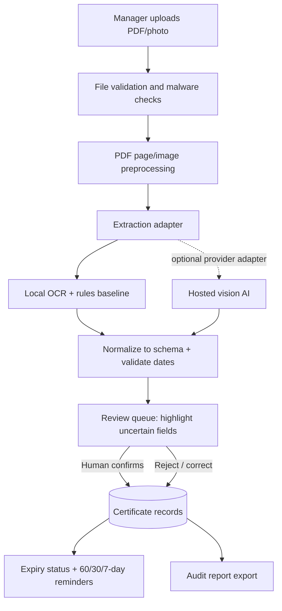

# CertiKeep — first technical decision (19 October 2026)

## Problem and decision
CertiKeep helps small and medium-sized construction firms track safety training, first-aid certificates, forklift licences and other worker credentials. The first technical question is how to turn PDFs, scans and phone photos into reviewable structured records. Based on the project interviews, the system must never silently treat an extracted value as proof of legal compliance.

## Candidate comparison

| Dimension | A. Hosted vision AI API | B. Local OCR + deterministic rules |
|---|---|---|
| Output quality | Likely stronger on varied layouts and contextual field identification; must be tested | Good on clean, predictable text; weaker when layout/labels vary |
| Cost per unit of work | Per-token/image API charges; scales with volume; needs monitoring | No per-request model fee; compute, setup and maintenance still cost money |
| Latency | Network round trip plus model processing; depends on provider/load | Usually fast on a local machine; image preprocessing/OCR time varies |
| Data needed | Image/PDF page plus prompt/schema; avoid sending unnecessary pages | Image/PDF page; OCR runs locally; needs suitable language packs |
| Failure modes | Hallucinated or misread dates, malformed output, provider outage, privacy/data-transfer concerns | OCR character errors, ambiguous dates, brittle patterns, unseen layouts |
| Vendor lock-in / switching | Medium–high if provider-specific prompts, schemas and APIs leak into app | Low–medium; OCR engine can be replaced behind an adapter, but rules still need maintenance |

## Chosen direction
**Prototype a provider-neutral extraction interface, with local OCR/rules as the baseline and a hosted vision model as the candidate to test next.** Do not commit to a production vendor based on assumptions. The current runnable experiment measures a local date-parser baseline on 10 synthetic OCR-text cases; it does not compare model quality yet.

## Three limitations
1. The current experiment uses synthetic text, not real certificate images, so it does not measure OCR or real-world accuracy.
2. Date formats and certificate layouts vary; a correct date can still be associated with the wrong field or worker.
3. Extracted data cannot establish that a worker is legally cleared for a particular site/task; a qualified person must verify the record and applicable requirements.

## What would make us switch
Run both approaches on the same consented, redacted or synthetic set of at least 50 representative documents. Switch the default if the alternative improves exact-match accuracy for expiry dates and certificate types by a meaningful margin (initial target: +10 percentage points), while meeting an agreed latency and cost budget, and passing privacy/security review. Any wrong expiry date is a high-severity error and must be routed for human review.

## First cost estimate (19 October 2026)
Candidate for pricing calculation: **OpenAI GPT-6 Luna**, using published standard short-context rates: $0.05 / 1,000,000 input tokens and $0.25 / 1,000,000 output tokens. Source: https://developers.openai.com/api/docs/pricing?tab=suite (checked 19 October 2026). Rates can change; confirm before implementation.

Illustrative text-only request (not an image-token estimate):
- 1,500 input tokens × $0.05 / 1,000,000 = $0.000075
- 200 output tokens × $0.25 / 1,000,000 = $0.000050
- Estimated model cost per action = **$0.000125** (0.0125 US cents), excluding image tokens, retries, taxes, infrastructure and any long-context or regional surcharge.

A certificate image incurs additional billable image input tokens, so this is a lower-bound illustration, not a complete image-processing quote. Use the official image-cost calculator for actual dimensions/detail: https://developers.openai.com/api/docs/guides/image-cost-calculator. Local Tesseract OCR is open-source under Apache 2.0, but deployment/compute and engineering are not free: https://github.com/tesseract-ocr/tesseract/blob/main/LICENSE.

## First architecture sketch

## Plan to MVP

| Task | Owner | Start | Due |
|---|---|---:|---:|
| Finalise certificate fields and status rules | Whole group | 19 Oct 2026 | 20 Oct 2026 |
| Run baseline experiment and record result | Whole group | 19 Oct 2026 | 19 Oct 2026 |
| Create 50-case synthetic/redacted evaluation set | Whole group | 20 Oct 2026 | 22 Oct 2026 |
| Implement extraction adapter and JSON schema | Whole group | 21 Oct 2026 | 26 Oct 2026 |
| Test hosted vision candidate against same cases | Whole group | 23 Oct 2026 | 27 Oct 2026 |
| Build human-review screen and corrections | Whole group| 26 Oct 2026 | 30 Oct 2026 |
| Add expiry statuses and reminder scheduler | Whole group | 29 Oct 2026 | 3 Nov 2026 |
| Add audit export, privacy checks and demo | Whole group | 3 Nov 2026 | 6 Nov 2026 |

